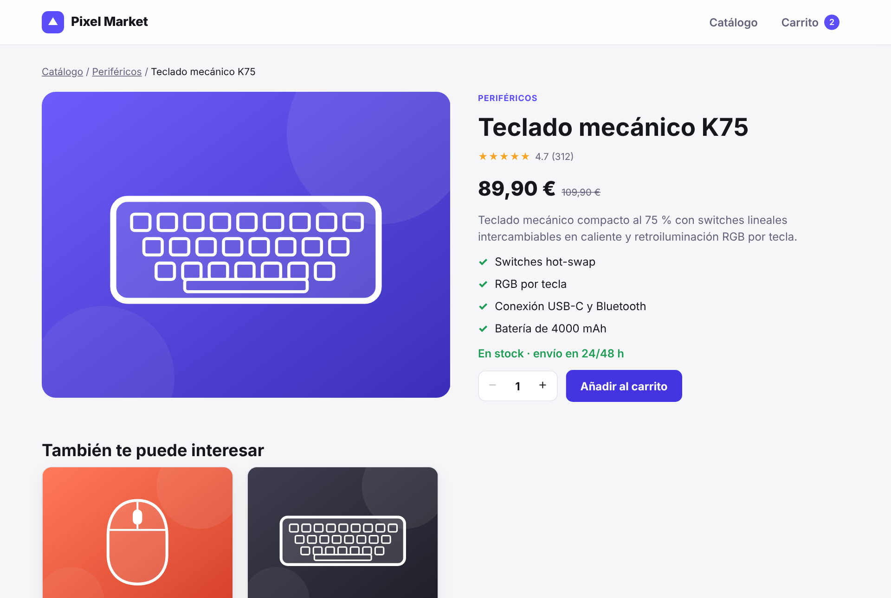
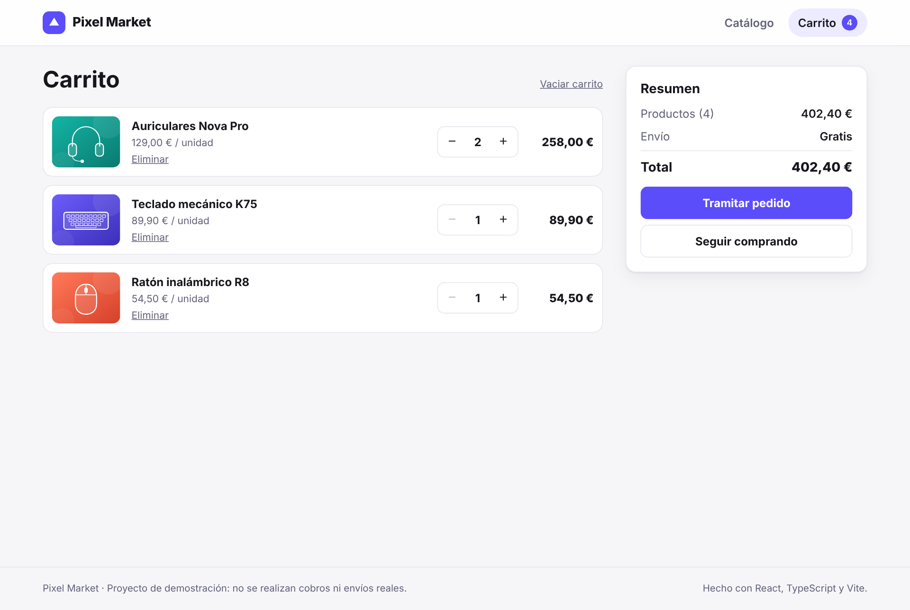
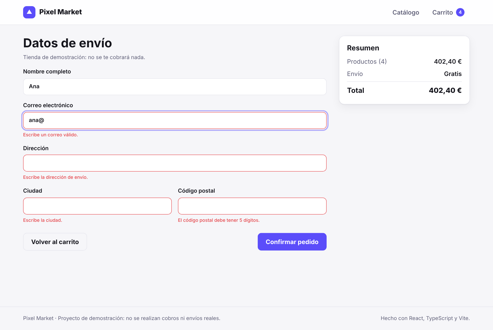
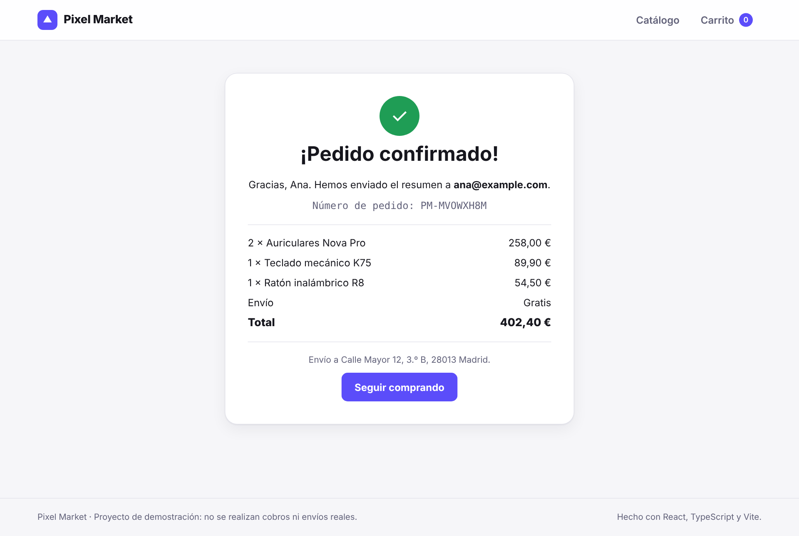

# Pixel Market · Tienda online en React + TypeScript

Tienda online de tecnología y gaming: catálogo con búsqueda y filtros, ficha de producto, carrito persistente y proceso de compra con validación. Es un proyecto de demostración: no hay pagos ni envíos reales.


## Funcionalidades

- **Catálogo** con búsqueda por texto, filtro por categoría, solo ofertas y ordenación por precio, popularidad o valoración. Los filtros se guardan en la URL, así que se pueden compartir y sobreviven a recargar la página.
- **Ficha de producto** con selector de cantidad limitado al stock disponible y productos relacionados.
- **Carrito** con estado global (React Context + `useReducer`), guardado en `localStorage`.
- **Envío gratis** a partir de 50 € y cálculo automático de subtotal, envío y total.
- **Checkout** con validación de formulario accesible (mensajes de error asociados a cada campo y foco en el primer error).
- **Confirmación de pedido** con número de pedido y resumen.
- Diseño **responsive** con **modo oscuro** automático.
- **Tests unitarios** del carrito y de la validación con Vitest.

## Tecnologías

React 19 · TypeScript · Vite · React Router (HashRouter) · Vitest · CSS propio sin frameworks · GitHub Pages

## Cómo está organizado

```
src/
├── cart/
│   ├── cartReducer.ts      # Lógica pura del carrito (añadir, cambiar cantidad, quitar, vaciar)
│   ├── cartReducer.test.ts
│   ├── CartContext.tsx     # Provider: conecta el reductor con localStorage y calcula totales
│   └── useCart.ts          # Contexto y hook para usar el carrito en cualquier componente
├── components/             # Piezas reutilizables: tarjeta, precio, valoración, cantidad…
├── data/products.ts        # Catálogo de productos y categorías
├── lib/
│   ├── format.ts           # Formato de precios en euros y reglas de envío
│   └── validation.ts       # Validación de los datos de envío
└── pages/                  # Catálogo, ficha, carrito, checkout y confirmación
```

### Decisiones técnicas

- **`useReducer` en vez de varios `useState`**: toda la lógica del carrito está en una función pura (`cartReducer`), fácil de testear y que nunca deja cantidades por encima del stock.
- **Filtros en la URL** con `useSearchParams`: el estado de la búsqueda no se pierde al navegar ni al recargar.
- **`HashRouter`**: las rutas funcionan en GitHub Pages sin configurar el servidor.
- **Ilustraciones en SVG** generadas desde los datos de cada producto: la web no depende de imágenes externas y pesa poco.

## Ejecutar en local

```bash
npm install
npm run dev      # servidor de desarrollo
npm test         # tests unitarios
npm run build    # versión de producción
npm run deploy   # publicar en GitHub Pages
```

## Capturas

| Ficha de producto | Carrito |
| --- | --- |
|  |  |

| Validación del checkout | Pedido confirmado |
| --- | --- |
|  |  |

## Próximas mejoras

- Conectar el catálogo a una API real.
- Pasarela de pago en modo de pruebas (Stripe).
- Tests de componentes con Testing Library.
